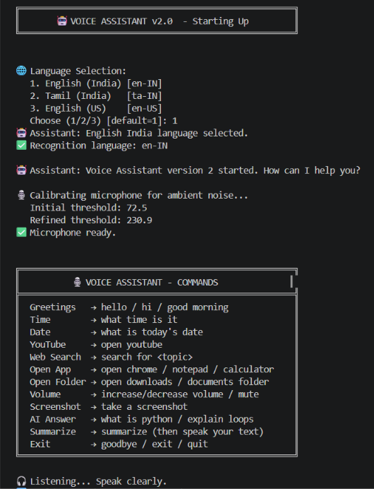

# 🎙️ Voice Assistant v2.0

> A smart, offline-capable Python voice assistant with AI intelligence, desktop automation, bilingual support (Tamil & English), and real-time speech recognition — running fully on your local machine.

---

## 🖥️ Output Preview



> The terminal shows the assistant starting up with language selection, two-phase microphone calibration, the full command menu, and entering listening mode — all in a clean, colorful interface.

---

## 📋 Table of Contents

- [Features](#-features)
- [Project Structure](#-project-structure)
- [Tech Stack](#-tech-stack)
- [Installation](#-installation)
- [Configuration](#-configuration)
- [Running the Assistant](#-running-the-assistant)
- [Voice Commands](#-voice-commands)
- [How It Works](#-how-it-works)
- [Model Details](#-model-details)
- [Upgrade Summary (v1 → v2)](#-upgrade-summary-v1--v2)
- [Future Improvements](#-future-improvements)

---

## ✨ Features

| Feature | Description |
|---|---|
| 🎙️ **Bilingual Recognition** | Supports Tamil (`ta-IN`) and English (`en-IN`, `en-US`) |
| 🧠 **AI-Powered Answers** | Uses Google Gemini 2.0 Flash to answer any question |
| 🖥️ **Desktop Automation** | Opens apps, folders, controls volume, takes screenshots |
| 🔊 **Text-to-Speech** | Natural voice responses via `pyttsx3` |
| 🎯 **Smart Intent Detection** | Hybrid rule-based + ML classification (LinearSVC) |
| 📸 **Screenshot Capture** | Saves timestamped screenshots to `~/Pictures/VoiceAssistant/` |
| 🌐 **Web Search** | Google search and YouTube launch via voice |
| 🔄 **Auto Retry** | Retries failed recognition automatically (up to 2×) |
| 🎚️ **Volume Control** | Increase, decrease, mute/unmute system volume |
| 📝 **Text Summarization** | Summarizes spoken text using Gemini AI |

---

## 📁 Project Structure

```
VoiceAssistant/
│
├── assistant.py          # Main voice assistant (v2.0)
├── train_model.py        # ML model training script
├── intants.csv           # Training dataset (172 examples, 15 intents)
├── output_screenshot.png # Sample output / terminal preview
├── README.md             # This file
│
├── models/
│   └── voice_intant_model.joblib   # Trained LinearSVC model (58 KB)
│
└── .venv/                # Python virtual environment
```

---

## 🛠️ Tech Stack

| Library | Version | Purpose |
|---|---|---|
| `SpeechRecognition` | 3.17.0 | Microphone input & Google Speech API |
| `pyttsx3` | 2.99 | Offline Text-to-Speech |
| `scikit-learn` | 1.9.1 | ML intent classification (LinearSVC + TF-IDF) |
| `joblib` | 1.6.0 | Model serialization |
| `pyautogui` | 0.9.54 | Screenshot capture |
| `pycaw` | 20260927 | Windows volume control |
| `Pillow` | 13.0.0 | Image processing for screenshots |
| `google-genai` | 3.1.0 | Gemini AI (questions & summarization) |
| `psutil` | 7.2.2 | System process information |
| `PyAudio` | 0.2.14 | Microphone audio stream |
| `pywin32` | 312 | Windows system integration |

---

## ⚙️ Installation

### Prerequisites
- Python 3.13+
- Windows OS (10/11)
- Microphone connected
- Internet connection (for Google Speech API & Gemini AI)

### Steps

**1. Clone or download the project:**
```bash
cd d:\
# Place the VoiceAssistant folder here
```

**2. Create a virtual environment:**
```bash
python -m venv .venv
.venv\Scripts\activate
```

**3. Install all dependencies:**
```bash
pip install SpeechRecognition pyttsx3 pyaudio scikit-learn joblib
pip install pyautogui pillow pycaw psutil google-genai
pip install pywin32
```

**4. Train the intent model:**
```bash
python train_model.py
```

---

## 🔧 Configuration

### Enable Gemini AI (optional but recommended)

### 🔒 Secure API Key Configuration (Recommended)

All sensitive keys and configurations are safely isolated in `.env` and automatically excluded from version control via `.gitignore`.

1. Copy the example template (if `.env` does not exist):
   ```bash
   cp .env.example .env
   ```
2. Open [`.env`](file:///d:/VoiceAssistant/.env) and insert your private Gemini key:
   ```env
   GEMINI_API_KEY=AIzaSy...your_actual_key_here
   ```
   > 🔑 Get a **free API key** at [Google AI Studio](https://aistudio.google.com).
   >
   > ⚠️ **Security Tip:** Never commit `.env` to Git or share it. Only `.env.example` should be shared in repositories.

Alternatively, you can provide the key directly via PowerShell environment variables:
```powershell
$env:GEMINI_API_KEY = "your-api-key-here"
```

### Change Language
When the assistant starts, choose your preferred language:
```
Language Selection:
  1. English (India) [en-IN]   ← default
  2. Tamil (India)   [ta-IN]
  3. English (US)    [en-US]
```

---

## ▶️ Running the Assistant

```bash
# Activate virtual environment
d:\VoiceAssistant\.venv\Scripts\activate

# Run the assistant
python assistant.py
```

**Expected startup sequence:**
1. 🌐 Language selection menu appears
2. 🔊 TTS says *"Voice Assistant version 2 started"*
3. 🎙️ Two-phase microphone calibration (3 seconds)
4. 📋 Command menu displays
5. 👂 *"Listening... Speak clearly."* — ready!

---

## 🗣️ Voice Commands

```
╔══════════════════════════════════════════════════════╗
║          🎙️  VOICE ASSISTANT - COMMANDS              ║
╠══════════════════════════════════════════════════════╣
║  Greetings   → hello / hi / good morning             ║
║  Time        → what time is it                       ║
║  Date        → what is today's date                  ║
║  YouTube     → open youtube                          ║
║  Web Search  → search for <topic>                    ║
║  Open App    → open chrome / notepad / calculator    ║
║  Open Folder → open downloads / documents folder     ║
║  Volume      → increase/decrease volume / mute       ║
║  Screenshot  → take a screenshot                     ║
║  AI Answer   → what is python / explain loops        ║
║  Summarize   → summarize (then speak your text)      ║
║  Exit        → goodbye / exit / quit                 ║
╚══════════════════════════════════════════════════════╝
```

### Detailed Command Examples

#### 👋 Greetings
```
"hello"  |  "hi"  |  "good morning"  |  "namaste"  |  "vanakkam"
```

#### ⏰ Time & Date
```
"what time is it"           → The current time is 10:30 AM
"what is today's date"      → Today is Wednesday, 11 November 2026
```

#### 🌐 Web
```
"search for python tutorials"      → Opens Google search
"find latest cricket score"        → Opens Google search
"open youtube"                     → Opens YouTube
```

#### 🖥️ Applications
```
"open chrome"           → Launches Google Chrome
"open notepad"          → Launches Notepad
"open calculator"       → Launches Calculator
"open vs code"          → Launches Visual Studio Code
"open task manager"     → Launches Task Manager
"open file explorer"    → Launches File Explorer
```

#### 📂 Folders
```
"open downloads folder"    → Opens ~/Downloads
"open documents folder"    → Opens ~/Documents
"open desktop folder"      → Opens ~/Desktop
"open pictures folder"     → Opens ~/Pictures
```

#### 🔊 Volume
```
"increase volume"   |   "volume up"       → +10%
"decrease volume"   |   "volume down"     → -10%
"mute"              |   "mute the volume" → Mutes
"unmute"            |   "turn on sound"   → Unmutes
```

#### 📸 Screenshot
```
"take a screenshot"   |   "capture the screen"   |   "screenshot please"
→ Saved to: C:\Users\<you>\Pictures\VoiceAssistant\screenshot_YYYYMMDD_HHMMSS.png
```

#### 🤖 AI Questions (requires Gemini API key)
```
"what is python"                    → AI explains Python
"explain machine learning"          → AI explains ML
"how does the internet work"        → AI explains the internet
"what is artificial intelligence"   → AI explains AI
```

#### 📝 Summarize (requires Gemini API key)
```
"summarize"  → Assistant asks you to speak your text → Returns 2-3 sentence summary
```

#### 🚪 Exit
```
"goodbye"  |  "bye"  |  "exit"  |  "quit"  |  "shut down"  |  "that's all"
```

---

## 🔬 How It Works

```
┌─────────────────────────────────────────────────────────┐
│                   Voice Assistant Flow                   │
└─────────────────────────────────────────────────────────┘

  🎙️ Microphone Input
        │
        ▼
  🔧 Ambient Noise Calibration (per-listen, 0.3s)
        │
        ▼
  🌐 Google Speech API (en-IN / ta-IN / en-US)
        │          │
        │       [Failed] ──► Auto-retry (up to 2×)
        │          │
        │       [Tamil fails] ──► Fallback to en-IN
        ▼
  📝 Transcribed Text
        │
        ▼
  🧠 Intent Detection (Layered):
     1. Direct keyword match (exit, greetings, time, date...)
     2. Keyword/prefix rules (volume, apps, folders, search...)
     3. ML Model: TF-IDF + LinearSVC (confidence ≥ 0.3)
     4. Fallback: "unknown"
        │
        ▼
  ⚡ Action Execution:
     • Web actions    → webbrowser
     • Apps/Folders   → subprocess / os.startfile
     • Volume         → pycaw / ctypes
     • Screenshot     → pyautogui / Pillow
     • AI Answer      → Google Gemini 2.0 Flash
     • TTS Response   → pyttsx3
        │
        ▼
  🔄 Loop back to listening
```

---

## 🤖 Model Details

| Property | Value |
|---|---|
| **Algorithm** | LinearSVC (Support Vector Machine) |
| **Features** | TF-IDF Vectorizer (1-gram + 2-gram) |
| **Training Examples** | 172 |
| **Intent Classes** | 15 |
| **Model File Size** | 58,128 bytes (~58 KB) |
| **Confidence Threshold** | 0.3 (decision function score) |

### Intent Classes
```
ask_ai        exit          get_date      get_time
greeting      open_app      open_folder   open_youtube
screenshot    summarize     volume_down   volume_mute
volume_unmute volume_up     web_search
```

### Retraining the Model
Whenever you add new examples to `intants.csv`, retrain:
```bash
python train_model.py
```

---

## 📈 Upgrade Summary (v1 → v2)

| Component | v1.0 | v2.0 |
|---|---|---|
| **Training Examples** | 51 | 172 (+237%) |
| **Intent Classes** | 6 | 15 (+150%) |
| **Languages** | English only | Tamil + English (3 options) |
| **Mic Calibration** | Single pass (2s) | Two-phase + per-listen |
| **Recognition Retry** | None | Auto-retry up to 2× |
| **Confidence Threshold** | 0.5 | 0.3 (more inclusive) |
| **Desktop Automation** | ❌ | ✅ Apps, Folders, Volume, Screenshot |
| **AI Intelligence** | ❌ | ✅ Gemini 2.0 Flash |
| **Volume Control** | ❌ | ✅ pycaw + ctypes fallback |
| **Screenshot** | ❌ | ✅ pyautogui + Pillow |
| **Greeting Context** | Static | Time-aware (morning/afternoon/evening) |
| **Idle Detection** | ❌ | ✅ "Are you still there?" after 5 misses |

---

## 🚀 Future Improvements

- [ ] **Wake word detection** — always-on with *"Hey Assistant"* trigger
- [ ] **WhatsApp / Email integration** — send messages by voice
- [ ] **Weather API** — *"What's the weather in Chennai?"*
- [ ] **Music playback** — control Spotify/YouTube Music
- [ ] **Reminder & alarm system** — *"Remind me in 10 minutes"*
- [ ] **Custom app mapping** — user-defined app shortcuts via config file
- [ ] **GUI dashboard** — Tkinter/web UI with live transcript display
- [ ] **Offline AI fallback** — local LLM (Ollama) when no internet
- [ ] **Multi-language expansion** — Hindi, Telugu, Malayalam
- [ ] **Voice profiles** — different users with personalized responses

---

## 👨‍💻 Author

Built with ❤️ using Python, Google Speech API, scikit-learn, and Gemini AI.

---

## 📄 License

This project is for educational and personal use.
